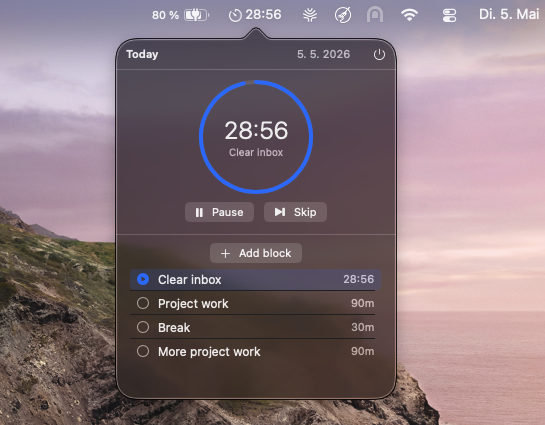

# Timeblock

A native macOS menu bar app for time-blocked deep work. Plan your day in blocks, run a per-block timer, and see a live countdown in the menu bar.



- Plan today (or any other day) as an ordered list of blocks.
- Start a block and watch it count down. Pause, resume or skip.
- A notification fires when a block ends.
- Data is stored locally with SwiftData and survives quitting, sleep and restarts.

## Requirements

- macOS 14 Sonoma or newer
- Xcode 15.4 or newer

## Build and run

```bash
git clone https://github.com/karlschneidewind/timeblock.git
cd timeblock
open Timeblock.xcodeproj
```

Press **⌘R** in Xcode. The timer icon appears in the menu bar.

Or build from the command line:

```bash
xcodebuild -project Timeblock.xcodeproj -scheme Timeblock -configuration Debug -derivedDataPath build build
open build/Build/Products/Debug/Timeblock.app
```

`Timeblock.xcodeproj` is generated from `project.yml` with [XcodeGen](https://github.com/yonaskolb/XcodeGen). After adding or removing source files, regenerate it with `xcodegen generate`.

## Usage

- **Add a block:** "Add block" or ⌘N.
- **Edit a block:** click its row.
- **Start, edit or delete:** right-click a row, or swipe left on it.
- **Reorder:** drag a row.
- **Change day:** click the date in the header.
- **Close the popover:** Esc, or click anywhere outside it.
- **Quit:** the ⏻ button or ⌘Q.

The notification permission prompt appears the first time you start a block.

## Project layout

```
Timeblock/
├── TimeblockApp.swift          # @main entry point
├── AppDelegate.swift           # menu bar status item, popover, countdown label
├── Info.plist
├── Assets.xcassets/            # AppIcon, AccentColor
├── Models/
│   ├── Block.swift             # @Model: one block
│   └── DailyPlan.swift         # @Model: a day with ordered blocks
├── Services/
│   ├── TimerEngine.swift       # @Observable timer, anchored to wall-clock time
│   ├── NotificationService.swift
│   └── PlanRepository.swift    # SwiftData fetch/insert/reorder
└── Views/
    ├── PopoverRootView.swift   # popover container, header, date picker
    ├── TimerHeaderView.swift   # countdown ring and controls
    ├── PlanListView.swift      # block list, swipe/context actions, reorder
    ├── BlockRowView.swift      # one row
    └── BlockEditorSheet.swift  # add/edit form
scripts/generate_icon.swift     # renders the AppIcon PNGs
```

## Notes

- When a block ends, the next pending block is shown but not started automatically. See `TimerEngine`.
- Data is local only, with no iCloud sync.
- The app currently also shows a Dock icon. To hide it, add `LSUIElement = YES` to `Timeblock/Info.plist`.
